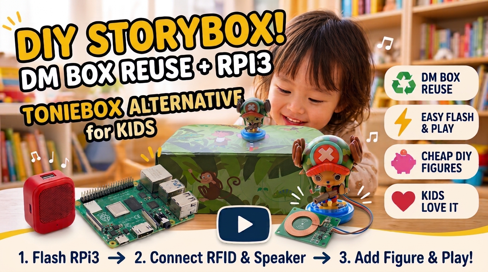

> A custom Raspberry Pi 3 image that ships a fully pre-configured [Phoniebox](https://github.com/MiczFlor/RPi-Jukebox-RFID) — the kids' audio player — which installs itself on first boot.
> Just flash it to an SD card, power on, and your little storybox is ready. No programming knowledge needed.

 

## Demo

## Features

* **Cheap, almost free figures** — the RFID figures that control the box are DIY: print or draw them yourself, stick on an NFC tag, done.
* **Phoniebox already installed and configured** — the image runs the whole installer unattended on first boot: reader, web app, Samba, kiosk mode all set up for you.
* **Automatic Wi-Fi configuration** — no keyboard, no terminal: the box opens a `Phoniebox_Setup` hotspot, you pick your home network in a setup portal from your phone, and it remembers it forever.
* **MeTube integrated** — download music and audiobooks from YouTube (and more) straight into the Phoniebox library from a simple web UI.
* **Services configured to start automatically** — hotspot, autohotspot fallback, first-boot installer, MeTube: everything is wired up as systemd services, no manual start, nothing to keep alive.
* **A ready-to-use system without Linux knowledge** — flash, plug in speakers and the RFID reader, power on. That's the whole setup.

## How it works

On first boot the image detects internet (cable, saved WiFi, or the setup
hotspot), installs Phoniebox unattended and reboots into a working
storybox. After that it behaves like a normal Phoniebox, with a fallback
hotspot whenever it can't reach a known network.

For the full setup instructions, build steps, preseed options, network
details and troubleshooting, see **[SETUP.md](SETUP.md)**.

### Sponsor Content

The phoniebox-image project is completely opensource, the code provides everything needed to build the image yourself with [rpi-image-gen](https://github.com/xeonqq/rpi-image-gen).
However, building requires a Debian machine and some patience. As a sponsor, you would be able to enjoy the following premium content:

* The pre-compiled, ready-to-flash image together with a comprehensive installation and wiring guide: download it, flash it with Balena Etcher or Raspberry Pi Imager, and your Phoniebox is running without any build setup.

  - [Ready to Flash Phoniebox Image + Installation Guide](https://payhip.com/b/wCUAa)
